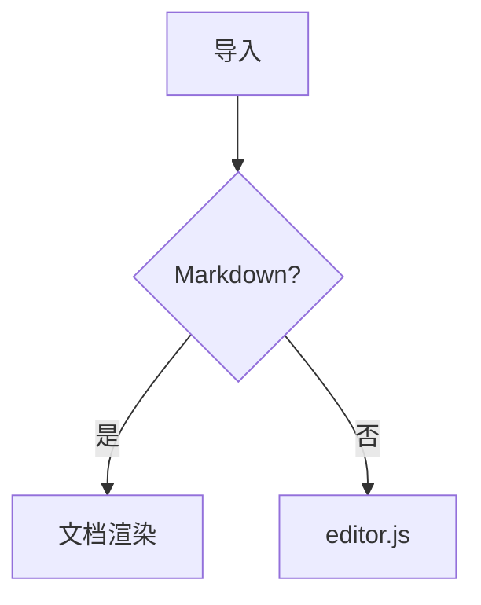

# GFM 验收样例

## 目录

- [段落与换行](#段落与换行)
- [代码](#代码)
- [公式](#公式)
- [跳到脚注](#fn1)

## 段落与换行

这是一段按固定宽度手动折行的段落，第一行到这里
第二行紧接着，在 VS Code 里这两行应该连成一段。

空行之后是新段落。**粗体**、*斜体*、~~删除线~~、`行内代码`、==高亮==、<kbd>Ctrl</kbd>+<kbd>C</kbd>、H<sub>2</sub>O、x<sup>2</sup>。

裸链接 https://code.visualstudio.com 和 [普通链接](https://github.com)。

## 列表

1. 有序一
2. 有序二
   - 嵌套无序
   - 嵌套无序
3. 有序三

- [x] 已完成任务
- [ ] 未完成任务

## 表格

| 左对齐 | 居中 | 右对齐 |
|:---|:---:|---:|
| a | b | c |
| 长一点的内容 | 中 | 1,234 |

## 引用与提示块

> 普通引用
>
> 第二段引用

> [!NOTE]
> GitHub 提示块：note

> [!TIP]
> GitHub 提示块：tip

> [!IMPORTANT]
> GitHub 提示块：important

> [!WARNING]
> GitHub 提示块：warning

> [!CAUTION]
> GitHub 提示块：caution

## 代码

```js
// JavaScript
function greet(name) {
  return `Hello, ${name}!`
}
```

```python
def fib(n):
    return n if n < 2 else fib(n - 1) + fib(n - 2)
```

```java
public record Point(int x, int y) {}
```

```sql
SELECT id, title FROM notes WHERE owner_id = 1 ORDER BY created_at DESC;
```

    缩进代码块



## 公式

行内公式 $E = mc^2$，价格 $5 和 $10 不是公式。

$$
\int_0^\infty e^{-x^2}\,dx = \frac{\sqrt{\pi}}{2}
$$

## 内嵌 HTML

<details>
<summary>点击展开</summary>

折叠的内容。

</details>


---

脚注引用[^1]。

[^1]: 这是脚注内容。
