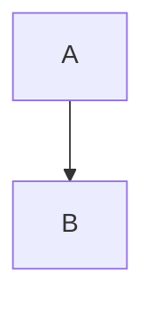

# 本周进展

## 进展概览
完成了 **网关** 改造，~~旧方案~~ 已下线，==重点==：延迟降到 5~10 ms。

| 指标 | 改造前 | 改造后 |
| --- | --- | --- |
| P99 | 120ms | 40ms |

> [!warning] 注意
> 灰度期间不要改配置

- [x] 压测
- [ ] 写复盘

1. 第一步

2. 第二步

#### 细节
质能方程 $E=mc^2$ 只是举例[^1]。

$$
\int_0^1 x\,dx = \frac{1}{2}
$$

![[架构图.png]]

参见 [[上周周报|上周]]。

[^1]: 来自维基百科。
